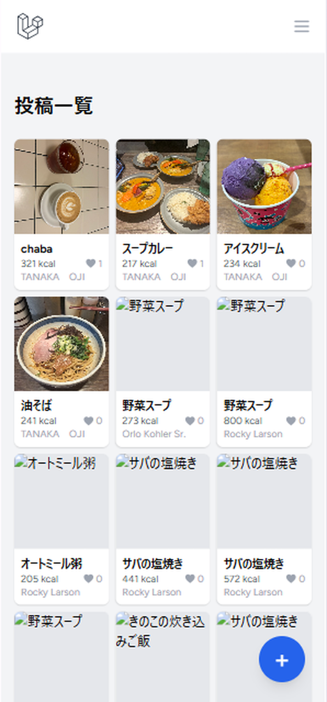
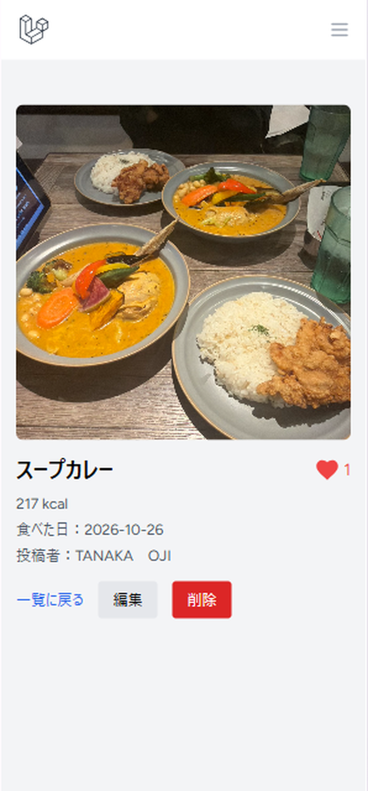
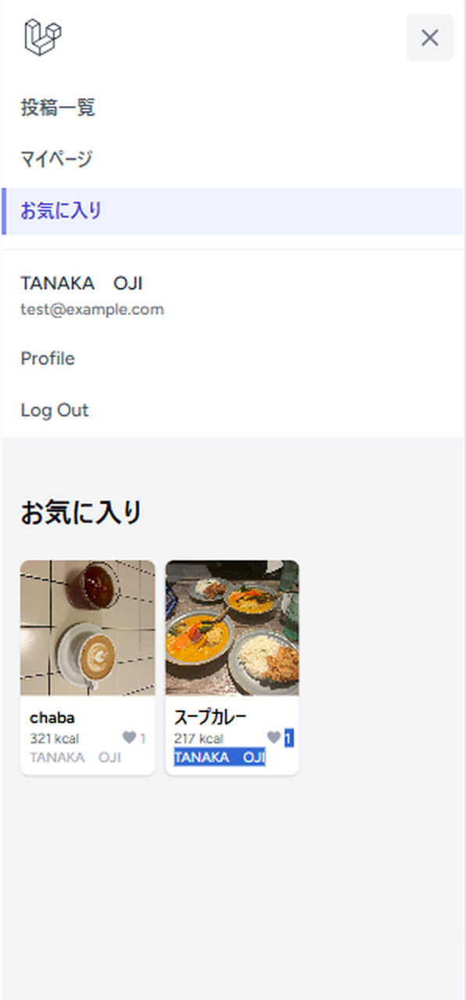
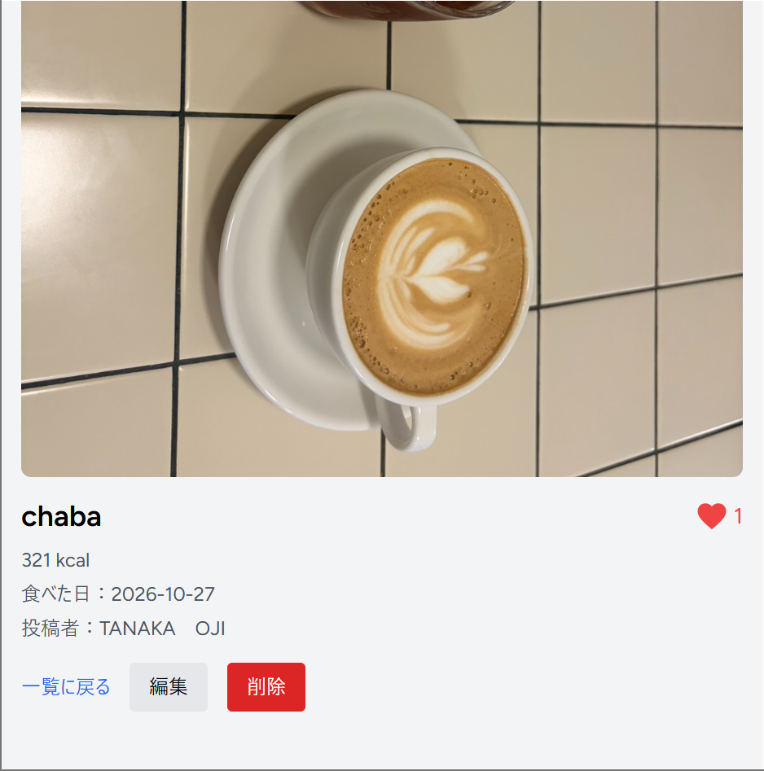
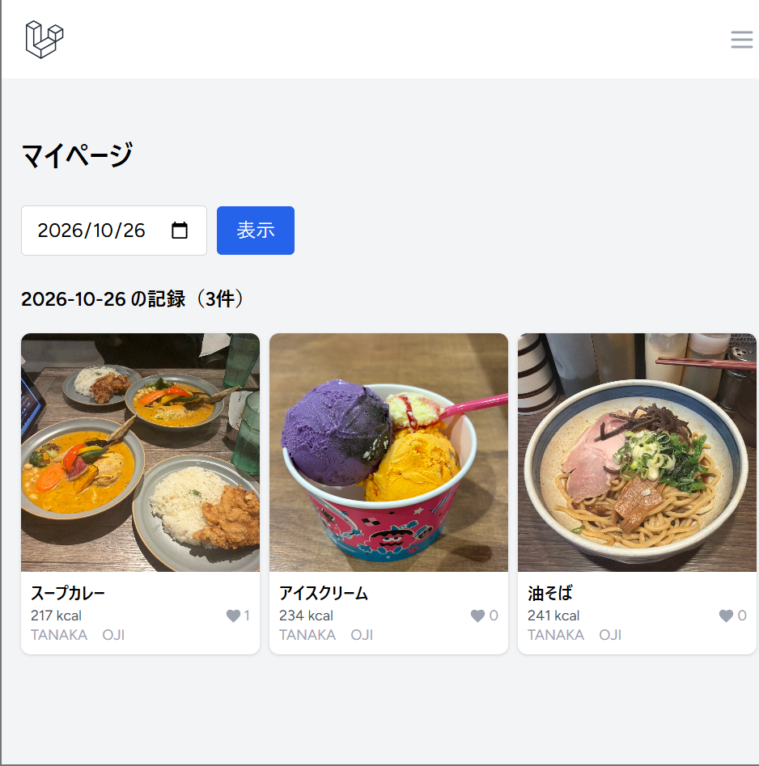
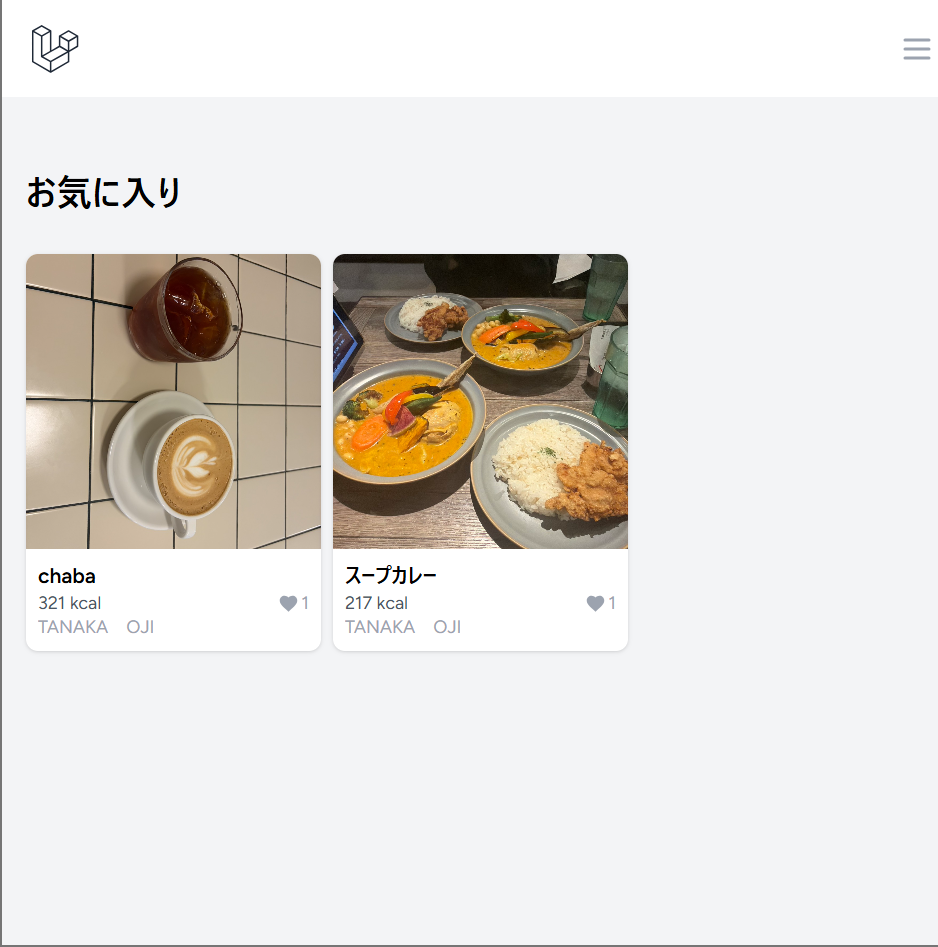

# gohan-log 🍚

ダイエット中の人が、食事を**写真とカロリー付きで記録**し、ほかの人の記録をお気に入りして献立の参考にできるアプリです。
ユーザーは食事を投稿し、自分の記録を食べた日で振り返ったり、ほかのユーザーの投稿を見てお気に入り登録したりできます。

**公開URL:** https://gohan.myapp-yuna.com
**設計書:** [docs/](docs/00_overview.md)（要件定義書・画面設計・DB設計・ルーティング設計・インフラ構成図・技術選定・スプリント計画）
**タスク管理:** [GitHub Projects](https://github.com/users/yunabuilds/projects/3)

## ✨ 主な機能

- ✅ ユーザー登録・ログイン・ログアウト（Laravel Breeze）
- ✅ 食事の投稿（写真・料理名・カロリー・食べた日・メモ）・一覧（1ページ12件）・詳細
- ✅ 投稿の編集・削除（Policy で自分の投稿のみ。他の人の投稿は 403）
- ✅ マイページで、自分の投稿を食べた日で絞り込み
- ✅ 写真のアップロード（10MBまで・ローカルの storage に保存）
- ✅ お気に入り（Ajax：ページを再読み込みせずに ♡ を切り替え）とお気に入り一覧
- ✅ スマホ対応（スマホでもメニューは ≡ から開ける）

ログインしていなくても、投稿の一覧・詳細は見ることができます。

## 🛠 技術スタック

### バックエンド
- PHP 8.2
- Laravel 12
- MySQL 8.4

### フロントエンド
- Blade
- Tailwind CSS
- Alpine.js（お気に入りの ♡ ボタン）

### インフラ
- 開発環境：Docker（nginx・PHP-FPM・MySQL・phpMyAdmin）
- 本番環境：AWS（EC2 + Docker、RDS for MySQL 8.4）
- Nginx（リバースプロキシ）・Let's Encrypt（HTTPS）・お名前.com（独自ドメイン）
- GitHub Actions（PR でテスト、main へのマージで EC2 に自動デプロイ）

### 開発ツール
- Git / GitHub（Issues・Projects・Pull Request）
- PHPUnit
- Figma（画面設計）
- Claude（AI を使った開発・学習）

## 📦 セットアップ方法

### 1. リポジトリのクローン
```bash
git clone https://github.com/yunabuilds/gohan-log.git
cd gohan-log   # Laravel は src/、設計書は docs/ にある
```

### 2. Docker 用の .env を作り、コンテナを起動
```bash
cp .env.example .env
# .env に APP_PORT=80、DB_PORT=3306、PMA_PORT=8080、MYSQL_DATABASE=laravel、MYSQL_ROOT_PASSWORD=secret を書く
docker compose up -d
```

### 3. 依存関係のインストール
```bash
docker compose exec app composer install
cd src && npm install && cd ..   # ホストPCで実行（appコンテナにはNode.jsが入っていないため）
```

### 4. Laravel の環境設定
```bash
cp src/.env.example src/.env
docker compose exec app php artisan key:generate
```

`src/.env` のデータベース設定を書き換えます。
```
DB_CONNECTION=mysql
DB_HOST=db
DB_PORT=3306
DB_DATABASE=laravel
DB_USERNAME=root
DB_PASSWORD=secret
```

### 5. マイグレーション・確認用のデータ・ストレージリンク
```bash
docker compose exec app php artisan migrate
docker compose exec app php artisan db:seed        # 確認用のダミー投稿（3人×5件）
docker compose exec app php artisan storage:link
```

### 6. 開発サーバー起動
```bash
cd src && npm run dev   # ホストPCで実行（動かしたままにする）
```

ブラウザで http://localhost を開くと表示されます。

### テスト
```bash
docker compose exec app php artisan test
```

## 📸 スクリーンショット

### スマホ
| 投稿一覧 | 詳細（♡・編集・削除） | メニュー・お気に入り |
|---|---|---|
|  |  |  |

### PC
#### 詳細


#### マイページ（日付で絞り込み）


#### お気に入り一覧


## 💡 工夫した点

1. **セキュリティ対策**
   - CSRF 保護・XSS 対策（`{{ }}`）・SQL インジェクション対策（Eloquent）で、害のある入力や、ほかのサイトからのなりすましを止める
   - Policy で「自分の投稿だけ」編集・削除できるようにした。ボタンを隠す（`@can`）だけでなく、URL を直接開いても 403 で止めるので、自分の投稿をほかの人に変えられない
   - スマホで撮った写真（数MB）でも投稿できるように、写真は 10MB までにした。PHP の初期設定は 2MB だったので、PHP・コンテナの Nginx・EC2 の Nginx の3か所の上限をそろえた
   - 本番は `APP_DEBUG=false` にして、エラーのときにファイルの場所や設定が見えないようにした。アプリのポートは `127.0.0.1` だけに開き、HTTPS の受付を通らない入口を作らないようにした

2. **パフォーマンス**
   - `with('user')`・`withCount('favorites')` で、投稿者や ♡ の数を1件ずつ取りに行かず、まとめて取り出して重くならないようにした（N+1 対策）

3. **使いやすさ**
   - 写真は投稿では必須、編集では差し替えるときだけ選ぶ。料理名を1文字直したいだけのときに、写真を選び直さなくていいようにした。差し替えたら古い写真を消し、使わない写真がたまらないようにした
   - ♡ は、ページを再読み込みせずに色と数だけ変わる。ログインしていないときは、401 を受け取ってログイン画面へ移動する
   - 投稿カードをコンポーネントにして、一覧・マイページ・お気に入りで同じ見た目にした。直すときはファイル1つで済む
   - エラーメッセージを日本語にした。投稿ボタンは Figma の設計どおり、スマホで押しやすい画面の右下に固定した

4. **設計と開発の進め方**
   - 要件定義 → 画面・DB・ルーティング設計 → スプリント計画 → Issue を閉じながら実装、の順で進めた。計画にない実装や、計画とのずれが見えるので、途中で調整できた（計画にない機能は作らない判断もできた）
   - 自動テスト（投稿・権限・お気に入り）を書き、PR を出すと GitHub Actions が毎回すべて実行する。手で確認するより漏れにくい

5. **本番運用**
   - 同じ EC2 で動くブログアプリと同じポートは使えないので、ポート（8002）とサブドメイン（gohan.myapp-yuna.com）を分けて、受付（Nginx）が住所で振り分けるようにした
   - `restart: unless-stopped` で、EC2 を再起動してもアプリが止まったままにならないようにした
   - main にマージすると、GitHub Actions が EC2 で更新の手順（git pull・migrate など）を自動で行う。毎回同じ手順で動くので、手作業のミスがなくなる

## 🚀 今後の拡張予定

- [ ] 1日の合計カロリー（US-9）
- [ ] レシピとして材料・作り方を公開（US-10）
- [ ] 体重の記録（US-11）
- [ ] 403・419 などのエラー画面の日本語化
- [ ] 写真を S3 に保存
- [ ] キーワード検索

## 📝 学習記録

このプロジェクトは、techmeets の AI 駆動開発カリキュラム（6ヶ月）の集大成として作成しました。

### 習得した技術
- Laravel（MVC・認証・Eloquent・Policy・FormRequest・Blade コンポーネント）
- Docker（開発環境・本番用の構成）
- Git / GitHub（Issue・ブランチ・PR・Projects）
- AWS（EC2・RDS）・Nginx・HTTPS・独自ドメイン
- CI/CD（GitHub Actions）
- テスト（PHPUnit）
- 設計（要件定義・Figma・DB 設計・ルーティング設計・スプリント計画）

## 👤 作成者

- GitHub: [@yunabuilds](https://github.com/yunabuilds)