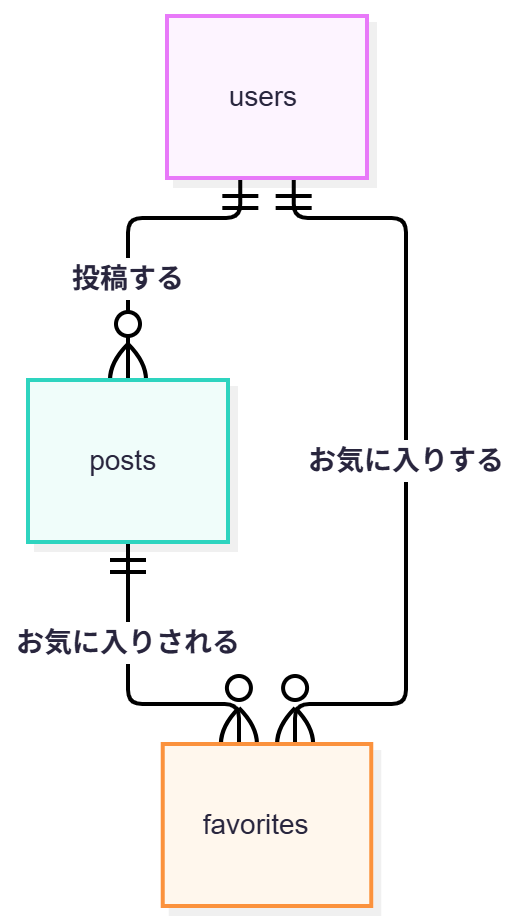
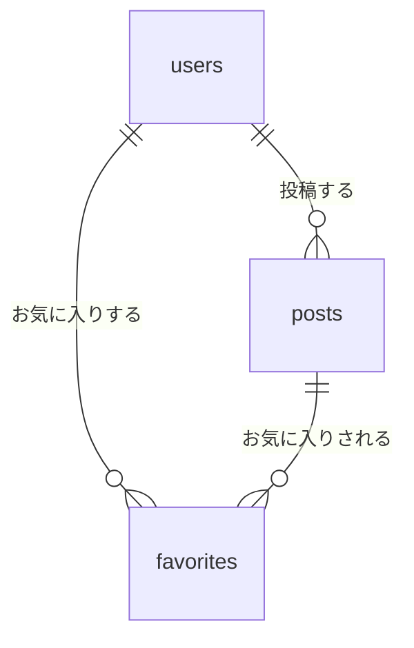

# テーブル定義書

## テーブル一覧
| テーブル | 説明 |
|---|---|
| users | ユーザー（Breeze が作成） |
| posts | 投稿（食事記録。材料・作り方が入ったものをレシピとして扱う） |
| favorites | お気に入り（users と posts の中間テーブル） |

※ password_reset_tokens・sessions・cache・jobs など、Laravel と Breeze が標準で作るテーブルは変更しないため省略する

## users（ユーザー）
| カラム名 | 型 | NULL | デフォルト | 説明 |
|---|---|---|---|---|
| id | BIGINT UNSIGNED | NO | AUTO | ユーザーID（PK） |
| name | VARCHAR(255) | NO | - | ユーザー名 |
| email | VARCHAR(255) | NO | - | メールアドレス |
| email_verified_at | TIMESTAMP | YES | NULL | メール確認日時 |
| password | VARCHAR(255) | NO | - | パスワード（ハッシュ化） |
| remember_token | VARCHAR(100) | YES | NULL | ログイン状態の保持 |
| created_at | TIMESTAMP | YES | NULL | 作成日時 |
| updated_at | TIMESTAMP | YES | NULL | 更新日時 |

【インデックス】
- PRIMARY KEY (id)
- UNIQUE KEY (email)

## posts（投稿）
| カラム名 | 型 | NULL | デフォルト | 説明 |
|---|---|---|---|---|
| id | BIGINT UNSIGNED | NO | AUTO | 投稿ID（PK） |
| user_id | BIGINT UNSIGNED | NO | - | 投稿したユーザーID（FK） |
| dish_name | VARCHAR(100) | NO | - | 料理名 |
| calories | INT UNSIGNED | NO | - | カロリー（kcal） |
| eaten_on | DATE | NO | - | 食べた日 |
| image_path | VARCHAR(255) | NO | - | 写真の保存先（storage 内のパス） |
| memo | TEXT | YES | NULL | メモ（任意） |
| ingredients | TEXT | YES | NULL | 材料（任意） |
| steps | TEXT | YES | NULL | 作り方（任意） |
| created_at | TIMESTAMP | YES | NULL | 作成日時 |
| updated_at | TIMESTAMP | YES | NULL | 更新日時 |

【インデックス】
- PRIMARY KEY (id)
- INDEX (user_id, eaten_on)：マイページで「自分の投稿を日付で絞り込む」「1日の合計カロリーを出す」ため
- INDEX (created_at)：投稿一覧を新しい順に並べるため

【外部キー】
- user_id REFERENCES users(id) ON DELETE CASCADE

【バリデーション】
- 写真：必須、画像ファイル、10MB まで
- 料理名：必須、100文字まで
- カロリー：必須、0 以上の整数
- 食べた日：必須、日付

## favorites（お気に入り）
| カラム名 | 型 | NULL | デフォルト | 説明 |
|---|---|---|---|---|
| id | BIGINT UNSIGNED | NO | AUTO | お気に入りID（PK） |
| user_id | BIGINT UNSIGNED | NO | - | お気に入りしたユーザーID（FK） |
| post_id | BIGINT UNSIGNED | NO | - | お気に入りされた投稿ID（FK） |
| created_at | TIMESTAMP | YES | NULL | 作成日時 |
| updated_at | TIMESTAMP | YES | NULL | 更新日時 |

【インデックス】
- PRIMARY KEY (id)
- UNIQUE KEY (user_id, post_id)：同じ人が同じ投稿を2回お気に入りできないようにする

【外部キー】
- user_id REFERENCES users(id) ON DELETE CASCADE
- post_id REFERENCES posts(id) ON DELETE CASCADE

## ER図

