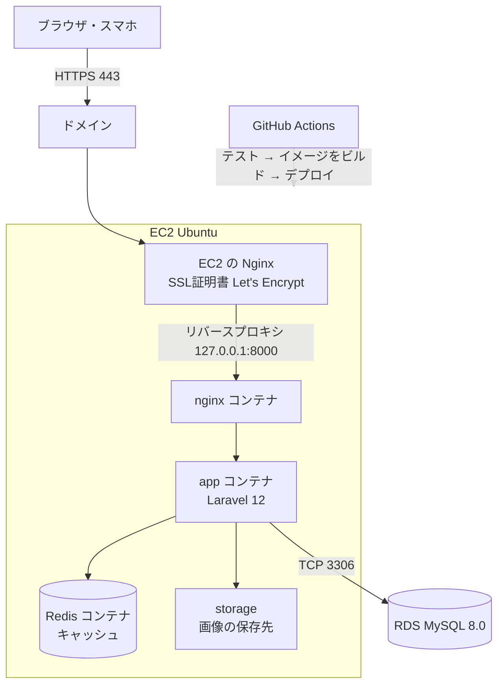

# インフラ構成図

## デプロイ先
**A：AWS を使い続ける**（EC2 ＋ Docker ＋ GitHub Actions）

Week 11〜17 で作った構成をそのまま使う。AWS の無料プランのクレジット（残り約108ドル、2027年3月1日まで）の範囲で運用する。

## 構成図

## 構成要素
| 役割 | 使うもの | 説明 |
|---|---|---|
| クライアント | ブラウザ・スマホ | HTTPS でアクセスする |
| Web サーバー | EC2 の Nginx、nginx コンテナ | HTTPS を受け付け、Laravel に取り次ぐ |
| アプリサーバー | app コンテナ（Laravel 12） | 画面を作る |
| データベース | RDS（MySQL 8.0） | ユーザー・投稿・お気に入りを保存する |
| キャッシュ | Redis コンテナ | Week 17 で導入 |
| ストレージ | storage（EC2 内） | 投稿の写真を保存する。S3 は余裕があれば対応する |
| CI/CD | GitHub Actions | main への push でテストとデプロイを自動で行う |

## ネットワーク（セキュリティグループ）
| 対象 | 開けるポート | 誰から |
|---|---|---|
| EC2 | 443（HTTPS）・80（HTTP → HTTPS に転送） | 誰でも |
| EC2 | 22（SSH） | 自分と GitHub Actions のみ |
| RDS | 3306（MySQL） | EC2 からのみ |

## 運用の注意
- 提出・レビュー期間以外は、費用を抑えるため EC2・RDS を停止することがある
- RDS は停止から7日で自動で起動するため、週に1回状態を確認する
- 画像は EC2 内に保存するため、EC2 を作り直すと消える