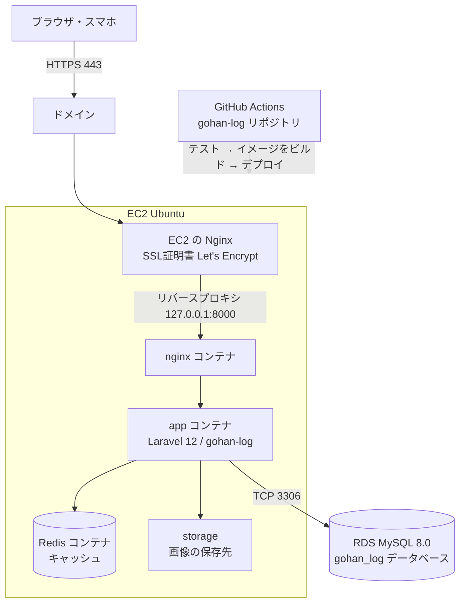

# インフラ構成図

## デプロイ先
**A：AWS を使い続ける**（EC2 ＋ Docker ＋ GitHub Actions）

Week 11〜17 で作った構成を使い回す。AWS の無料プランのクレジット（残り約108ドル、2027年3月1日まで）の範囲で運用する。

## 構成図

## 構成要素
| 役割 | 使うもの | 説明 |
|---|---|---|
| クライアント | ブラウザ・スマホ | HTTPS でアクセスする |
| Web サーバー | EC2 の Nginx、nginx コンテナ | HTTPS を受け付け、Laravel に取り次ぐ |
| アプリサーバー | app コンテナ（Laravel 12） | 画面を作る |
| データベース | RDS（MySQL 8.0） | ユーザー・投稿・お気に入り・体重の記録を保存する |
| キャッシュ | Redis コンテナ | Week 17 で導入 |
| ストレージ | storage（EC2 内） | 投稿の写真を保存する。S3 は余裕があれば対応する |
| CI/CD | GitHub Actions | gohan-log の main への push でテストとデプロイを自動で行う |

## ネットワーク（セキュリティグループ）
| 対象 | 開けるポート | 誰から |
|---|---|---|
| EC2 | 443（HTTPS）・80（HTTP → HTTPS に転送） | 誰でも |
| EC2 | 22（SSH） | 自分と GitHub Actions のみ |
| RDS | 3306（MySQL） | EC2 からのみ |

## Week 11〜17 の構成から変えること

Week 17 まで EC2 ではブログアプリ（techmeets-month2）を動かしていた。gohan-log は別のリポジトリのため、次のように切り替える。

| 項目 | 変更内容 | 理由 |
|---|---|---|
| EC2 | 同じ EC2 を使い、ブログアプリから gohan-log に入れ替える | 新しく作ると Nginx・SSL・セキュリティグループの設定をやり直すことになり、時間と費用がかかるため |
| 自動デプロイ | techmeets-month2 の Deploy ワークフローを止め、gohan-log に Deploy ワークフローを作る | 両方動いていると、片方のマージでもう片方が上書きされるため |
| データベース | 同じ RDS の中に gohan_log データベースを新しく作る | RDS を2台にすると費用が倍になるため |
| GitHub の Secrets | EC2 の接続情報などを gohan-log リポジトリにも登録する | Secrets はリポジトリごとに設定するため |

## 運用の予定
| 日程 | 作業 |
|---|---|
| 10/27 ごろ | RDS が停止から7日で自動起動する。デプロイまで停止せずにそのままにする |
| 10/29 | EC2 を起動し、gohan-log をデプロイする（作業時間がまとまってある日にするため） |
| 10/30 | 本番環境で動作を確認し、問題があれば直す |
| 提出・レビュー後 | 費用を抑えるため、EC2・RDS を停止する |

## 運用の注意
- 提出・レビュー期間以外は、費用を抑えるため EC2・RDS を停止することがある
- RDS は停止から7日で自動で起動するため、停止中は週に1回状態を確認する
- 画像は EC2 内に保存するため、EC2 を作り直すと消える