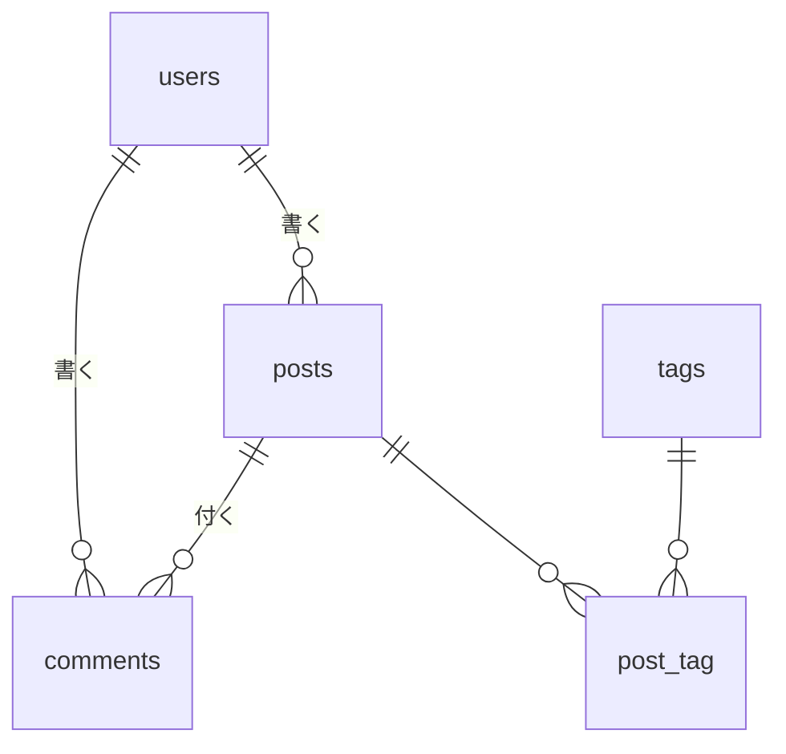

# 練習課題2：ブログシステムのDB設計

## テーブル一覧
| テーブル | 説明 |
|---|---|
| users | ユーザー |
| posts | 記事 |
| comments | コメント |
| tags | タグ |
| post_tag | 記事とタグの中間テーブル（多対多） |

## users（ユーザー）
| カラム名 | 型 | NULL | デフォルト | 説明 |
|---|---|---|---|---|
| id | BIGINT UNSIGNED | NO | AUTO | ユーザーID（PK） |
| name | VARCHAR(50) | NO | - | ユーザー名 |
| email | VARCHAR(255) | NO | - | メールアドレス |
| password | VARCHAR(255) | NO | - | パスワード（ハッシュ化） |
| created_at | TIMESTAMP | YES | NULL | 作成日時 |
| updated_at | TIMESTAMP | YES | NULL | 更新日時 |

【インデックス】PRIMARY KEY (id)、UNIQUE KEY (email)

## posts（記事）
| カラム名 | 型 | NULL | デフォルト | 説明 |
|---|---|---|---|---|
| id | BIGINT UNSIGNED | NO | AUTO | 記事ID（PK） |
| user_id | BIGINT UNSIGNED | NO | - | 書いたユーザーID（FK） |
| title | VARCHAR(200) | NO | - | タイトル |
| content | TEXT | NO | - | 本文 |
| published | BOOLEAN | NO | false | 公開状態 |
| created_at | TIMESTAMP | YES | NULL | 作成日時 |
| updated_at | TIMESTAMP | YES | NULL | 更新日時 |

【インデックス】PRIMARY KEY (id)、INDEX (user_id)、INDEX (created_at)
【外部キー】user_id REFERENCES users(id) ON DELETE CASCADE

## comments（コメント）
| カラム名 | 型 | NULL | デフォルト | 説明 |
|---|---|---|---|---|
| id | BIGINT UNSIGNED | NO | AUTO | コメントID（PK） |
| post_id | BIGINT UNSIGNED | NO | - | 記事ID（FK） |
| user_id | BIGINT UNSIGNED | NO | - | 書いたユーザーID（FK） |
| body | TEXT | NO | - | コメント本文 |
| created_at | TIMESTAMP | YES | NULL | 作成日時 |
| updated_at | TIMESTAMP | YES | NULL | 更新日時 |

【インデックス】PRIMARY KEY (id)、INDEX (post_id)
【外部キー】post_id REFERENCES posts(id) ON DELETE CASCADE、user_id REFERENCES users(id) ON DELETE CASCADE

## tags（タグ）
| カラム名 | 型 | NULL | デフォルト | 説明 |
|---|---|---|---|---|
| id | BIGINT UNSIGNED | NO | AUTO | タグID（PK） |
| name | VARCHAR(50) | NO | - | タグ名 |
| created_at | TIMESTAMP | YES | NULL | 作成日時 |
| updated_at | TIMESTAMP | YES | NULL | 更新日時 |

【インデックス】PRIMARY KEY (id)、UNIQUE KEY (name)：同じ名前のタグを2つ作らない

## post_tag（記事とタグの中間テーブル）
| カラム名 | 型 | NULL | デフォルト | 説明 |
|---|---|---|---|---|
| post_id | BIGINT UNSIGNED | NO | - | 記事ID（FK） |
| tag_id | BIGINT UNSIGNED | NO | - | タグID（FK） |

【インデックス】PRIMARY KEY (post_id, tag_id)：同じ記事に同じタグを2回付けない
【外部キー】post_id REFERENCES posts(id) ON DELETE CASCADE、tag_id REFERENCES tags(id) ON DELETE CASCADE

## ER図

## ポイント
- 1つの記事に複数のタグ、1つのタグに複数の記事が付く「多対多」なので、中間テーブル post_tag を作った
- テーブル名は Laravel の決まりに合わせ、2つのテーブル名の単数形をアルファベット順に並べた（post_tag）