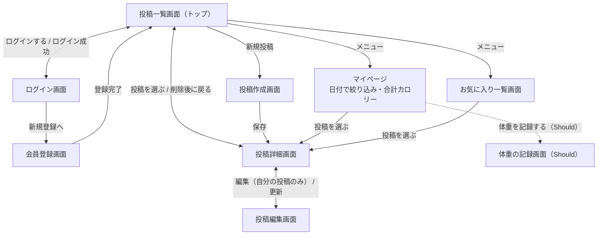

# gohan-log 要件定義書（確定版）

## 1. プロジェクト概要

### 背景
- ダイエットのため食事にも気を付けたいが、毎回の食事とカロリーを記録し続けるのは大変で、メモもバラバラになりがち。
- 献立も慣れていないうちは満足できなかったり、同じようなメニューになりがち。

### 目的
- 食事を写真とカロリー付きで記録し、自身の食生活を意識する。
- 他のユーザーとも共有し、ダイエットレシピを参考にできるようにする。
- 他のだれかと一緒に継続できる状態を作る。

### ターゲットユーザー（ペルソナ）

#### ペルソナ1：相田 さくら（仮）
■ 基本情報
- 19歳・大学生・一人暮らし
- 週3日は1限があり、忙しい日は朝ごはんを抜くこともある
- 最近ダイエットに興味を持ち始めた

■ 課題・ニーズ
- 忙しい日は朝ごはんを抜くなど食事が不規則だが、記録していないので自分では気づいていない
- 自分が何をどれくらい食べているか意識しておらず、食べたいものを食べてしまう
- サイトや動画でヘルシーな料理を探して作るが、作り方やおいしかった料理を忘れてしまい、続かない
- 1限がある日は時間がないので、記録に手間がかかると続かない

■ ゴール
- 普段の食事を見える形にして、1日にどれくらいのカロリーをとっているか知りたい
- 作ったことのあるレシピを見返して、リピートして作りたい

■ このペルソナから決まること
- 写真・カロリー付きで手早く投稿できる（Must）→ 忙しい日でも続けられる
- 日付で絞り込んで振り返れるマイページ（Must）
- 自分の投稿もお気に入りに入れて見返せる（Must）→ リピートしたい料理をすぐ探せる
- 材料・作り方を残せる（Should）、1日の合計カロリー（Should）

#### ペルソナ2：中野 美羽（仮）
■ 基本情報
- 26歳・会社員（フルタイム）
- 休日に作り置きをするが、疲れている日ややる気が出ない日は外食が多い

■ 課題・ニーズ
- 作り置きのメニューを考えるのが面倒で適当に作るため、料理がかぶって飽きてしまう
- 外食が増えて栄養バランスが悪くなり、不健康だと感じている
- 鏡を見て「ちょっと太ったかな」と思うことが増えたが、数字では確かめていない

■ ゴール
- 他の人が作る、健康的で外食よりおいしそうな料理を見つけて、自炊したい気持ちになりたい
- 自分の体の変化を、見た目ではなく数字で知りたい

■ このペルソナから決まること
- 写真が大きく並ぶ投稿一覧（Must）→「食べてみたい」と思える料理に出会える
- 他の人の投稿をお気に入りに保存できる（Must）→ 作り置きのメニューを決めるときに見返せる
- 材料・作り方を見られる（Should）→ 見つけた料理をそのまま作れる
- 体重の記録（Should）→ 変化を数字で確かめられる

### スコープ

**MVP（Must：10/24〜30 で必ず作る）**
- 会員登録・ログイン・ログアウト（Breeze）
- 食事の投稿・一覧・詳細・編集・削除（写真・料理名・カロリー・食べた日・メモ）
- 写真のアップロード（サーバー内に保存）
- 自分の投稿だけ編集・削除できる権限管理（Policy）
- マイページで自分の投稿を日付で絞り込み
- 自分や他の人の投稿へのお気に入り登録・解除（Ajax）と、お気に入り一覧

**時間が余ったら作るもの（Should：上から順に）**
1. 体重の記録
2. 1日の合計カロリー表示
3. 材料・作り方の入力（レシピとして公開）

**今回作らないもの（Won't：フェーズ2以降）**
- 運動の記録
- キーワード検索
- コメント
- 公開・非公開の切り替え、お店の名前
- AIによる栄養分析
- 地図表示、栄養素のグラフ
- 献立表

## 2. ユーザーストーリー

### 1.（Must）ログイン
ダイエット中のユーザーとして、自分のアカウントでログインしたい。なぜなら、自分の記録をまとめて管理し、続けて記録したいから。
- 受け入れ基準
  - 名前・メールアドレス・パスワードで会員登録できる
  - 登録したメールアドレスとパスワードでログイン・ログアウトできる

### 2.（Must）食事の記録
ダイエット中のユーザーとして、食べたものを写真とカロリー付きで記録したい。なぜなら、毎日の摂取カロリーを把握してダイエットに役立てたいから。
- 受け入れ基準
  - 写真・料理名・カロリー・食べた日を入力して投稿できる
  - 必須の項目が空のときや、写真以外のファイルを選んだときは、エラーが表示されて投稿されない

### 3.（Must）一覧・詳細
ダイエット中のユーザーとして、投稿を一覧で見て、気になったものの詳細を見たい。なぜなら、あとから食事の内容を見直したいから。
- 受け入れ基準
  - 投稿一覧に、全ユーザーの投稿が写真付きで新しい順に表示される（1ページ12件）
  - 投稿を選ぶと、詳細画面で写真・料理名・カロリー・食べた日・メモが見られる

### 4.（Must）お気に入り
ダイエット中のユーザーとして、自分や他の人の投稿をお気に入り登録したい。なぜなら、献立を考えるときやまた作りたいときに、すぐ見返したいから。
- 受け入れ基準
  - 一覧・詳細画面のボタンで、ページを再読み込みせずにお気に入りの登録・解除ができる
  - お気に入り一覧画面で、登録した投稿だけが見られる

### 5.（Must）編集
ダイエット中のユーザーとして、自分の投稿を編集したい。なぜなら、カロリーや食事内容を間違えたときに修正したいから。
- 受け入れ基準
  - 自分の投稿の詳細画面から編集画面に進み、内容を更新できる

### 6.（Must）削除
ダイエット中のユーザーとして、自分の投稿を削除したい。なぜなら、間違えて投稿したときに消したいから。
- 受け入れ基準
  - 自分の投稿の詳細画面から、確認ダイアログで「OK」を押すと削除できる

### 7.（Must）権限管理
ダイエット中のユーザーとして、自分の記録を他の人に編集・削除されないようにしたい。なぜなら、自分の記録を安心して残したいから。
- 受け入れ基準
  - 他の人の投稿には、編集・削除のボタンが表示されない
  - 他の人の投稿の編集・更新・削除の URL に直接アクセスすると、403 エラーになる

### 8.（Must）日付で絞り込み
ダイエット中のユーザーとして、自分の投稿を日付で絞り込みたい。なぜなら、いつ何を食べたかを振り返りたいから。
- 受け入れ基準
  - マイページで日付を選ぶと、その日に食べた自分の投稿だけが表示される

### 9.（Should）合計カロリー
ダイエット中のユーザーとして、1日の合計カロリーを確認したい。なぜなら、食べすぎていないかを確かめたいから。
- 受け入れ基準
  - マイページで日付を絞り込むと、その日の投稿のカロリーの合計が表示される

### 10.（Should）レシピの公開
ダイエット中のユーザーとして、自分のレシピを公開したい。なぜなら、自分のダイエットレシピを他の人と共有したいから。
- 受け入れ基準
  - 投稿するときに、材料・作り方を任意で入力できる
  - 材料・作り方が入った投稿は、詳細画面でそれらが表示される

### 11.（Should）体重の記録
ダイエット中のユーザーとして、体重を記録したい。なぜなら、体の変化を見た目ではなく数字で確かめたいから。
- 受け入れ基準
  - 日付と体重を入力して記録できる
  - マイページで、自分の体重の記録を日付の新しい順に一覧で見られる

## 3. 機能要件

### 機能一覧

「投稿」は、写真・料理名・カロリー・食べた日を必ず入力し、メモと材料・作り方は任意で入力する。材料・作り方が入った投稿を「レシピ」として扱う。

| ID | 機能 | 優先度 | MVP | 必須機能 | ストーリー |
|---|---|---|---|---|---|
| F-01 | 会員登録・ログイン・ログアウトができる | Must | ✅ | ログイン（Breeze） | 1 |
| F-02 | 写真・料理名・カロリー・食べた日を入力して投稿できる | Must | ✅ | CRUD（作成）・画像アップロード | 2 |
| F-03 | 投稿の一覧・詳細を見られる | Must | ✅ | CRUD（一覧・詳細） | 3 |
| F-04 | ページを再読み込みせずに、自分や他の人の投稿のお気に入り登録・解除ができる | Must | ✅ | Ajax | 4 |
| F-05 | 自分の投稿を編集できる | Must | ✅ | CRUD（編集） | 5 |
| F-06 | 自分の投稿を削除できる | Must | ✅ | CRUD（削除） | 6 |
| F-07 | 他の人の投稿は編集・削除できない | Must | ✅ | 権限管理（Policy） | 7 |
| F-08 | マイページで自分の投稿を日付で絞り込める | Must | ✅ | 検索・絞り込み | 8 |
| F-09 | 1日の合計カロリーを確認できる | Should | − | − | 9 |
| F-10 | 材料・作り方を入力して、レシピとして公開できる | Should | − | − | 10 |
| F-11 | 体重を記録し、一覧で見られる | Should | − | − | 11 |

### 詳細仕様

**投稿の項目**

| 項目 | 入力 | 備考 |
|---|---|---|
| 写真 | 必須 | 画像ファイルのみ・1枚10MBまで |
| 料理名 | 必須 | 100文字まで |
| カロリー | 必須 | 0以上の整数（kcal） |
| 食べた日 | 必須 | 初期値は今日の日付 |
| メモ | 任意 | |
| 材料・作り方 | 任意 | Should（F-10） |

**体重の記録の項目（Should）**

| 項目 | 入力 | 備考 |
|---|---|---|
| 日付 | 必須 | 初期値は今日の日付 |
| 体重 | 必須 | 数字（kg・小数第1位まで） |

- 体重の記録は本人だけが見られる（他のユーザーには公開しない）
- 体重は1日1件まで記録できる

### 画面遷移図

清書版（Figma）は docs/01_screen-design/ にある。

- お気に入りの登録・解除は、投稿一覧画面と投稿詳細画面でボタンを押して行う（Ajax のため画面は移動しない）
- 削除は投稿詳細画面で行い、確認ダイアログで「OK」を押すと削除して投稿一覧画面に戻る
- 投稿作成・お気に入り・マイページ・体重の記録は、ログインしていないとログイン画面に移動する
- ログアウトすると、投稿一覧画面に戻る
- 点線は Should の機能で、時間が余った場合に作る

## 4. 非機能要件

### パフォーマンス
- 各ページは3秒以内に表示する（LCPは2.5秒以内を目標とする）
- 投稿できる画像は1枚10MBまでとする
- 投稿一覧はページネーションで分けて表示する（1ページ12件）

### セキュリティ
- 通信はHTTPSで行う
- パスワードはハッシュ化して保存する
- XSS・CSRF対策を行う
- 他のユーザーの投稿は、編集・削除できないようにする
- APIキーやパスワードは .env で管理し、GitHubに公開しない

### 可用性
- 提出・レビュー期間（Week 22〜24）は、インターネットからアクセスできる状態にする
- それ以外の期間は、費用を抑えるためにサーバーを停止することがある

### 互換性（対応ブラウザ）
- Chrome・Safari・Edge の最新版で動作する
- スマホからも投稿・閲覧しやすい画面にする（レスポンシブ対応）

### 保守性
- 主要な機能に自動テスト（PHPUnit）を書く
- GitHub Actions でテストとコードチェックを自動で実行する

## 5. 制約条件

### 納期
- 教材上の期間は Week 22〜24（3週間）
- 講座の最終日が 2026年10月31日のため、実装は **10月24日〜30日**（作業時間は約26.5時間）で行う
- 10月31日は提出日とし、作業が遅れたときの予備にする
- Must（MVP）の工数は約29時間のため、Should は Must がすべて終わったときだけ作る

### 開発体制
- 開発者1人で、設計から実装・公開まで行う

### 予算
- 学習用のため、無料のサービスの範囲で運用する
- サーバーは AWS の無料プランのクレジット（残り約108ドル、2027年3月1日まで）の範囲で運用する
- 料金がかかる外部API（AI分析など）は使わない

### 技術スタック
- Laravel・Blade で作る Web アプリとする（ルートは routes/web.php）
- ログインは Laravel Breeze を使う
- データベースは MySQL を使う
- 開発環境は Docker、本番環境は AWS（EC2・RDS）を使う
- 画像はサーバー内（Laravel の storage）に保存する（S3 は余裕があれば対応する）
- コードと設計書は gohan-log リポジトリ1つで管理する（設計書は docs/、実装は src/）
- 詳しくは docs/06_tech-selection.md を参照

## 6. 初版（Week 18）からの変更点

- ペルソナを2名追加し、ターゲットユーザーを具体的にした
- スコープを MVP（Must）・Should・Won't に分け、MVP の範囲を決めた
- ユーザーストーリーに優先度と受け入れ基準を追加した
- お気に入りの対象を「他の人の投稿」から「自分や他の人の投稿」に広げた（ストーリー4・F-04）
- 講師との面談を受けて、体重の記録を Should（ストーリー11・F-11）、運動の記録を Won't に追加した
- スコープの「料理名・日付での検索」を「日付での絞り込み」に直した（キーワード検索は Won't のため）
- 実装期間を、予定に合わせて 10月24日〜30日（約26.5時間）に直した
- 画面遷移図を「3. 機能要件」の中に移した
- 詳細仕様の項目を、Week 19 の DB 設計（posts・weights テーブル）とそろえた