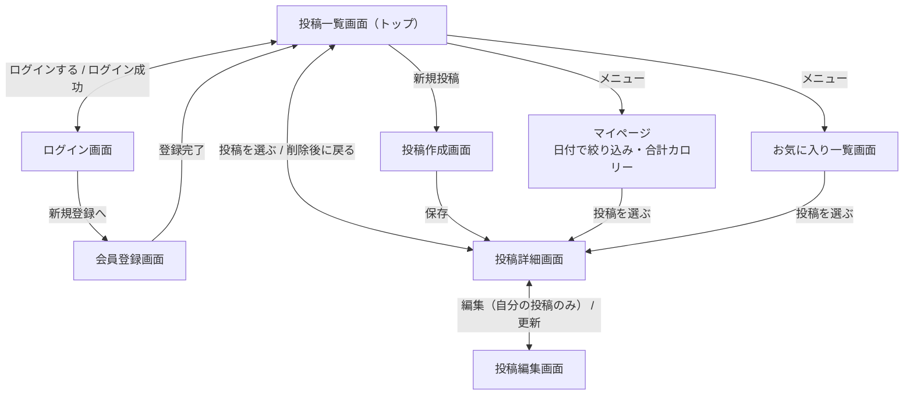

# gohan-log 要件定義書（初版）

## 1. プロジェクト概要
### 背景
- ダイエットのため食事にも気を付けたいが、毎回の食事とカロリーを記録し続けるのは大変で、メモもバラバラになりがち。
- 献立も慣れていないうちは満足できなかったり、同じようなメニューになりがち。

### 目的
- 食事を写真とカロリー付きで記録し、自身の食生活を意識する。
- 他のユーザーとも共有し、ダイエットレシピを参考にできるようにする。
- 他のだれかと一緒に継続できる状態を作る

### 対象ユーザー
- ダイエット中の人
- 食事管理をしたい人

### スコープ
**今回作るもの**
- ログイン・ログアウト
- 食事記録の投稿・一覧・詳細・編集・削除（写真・料理名・メモ・カロリー）
- 自分の記録だけ編集・削除できる権限管理
- 料理名・日付での検索
- 他のユーザーの記録へのお気に入り（Ajax）
- 自作レシピの登録、1日の合計カロリー表示（できれば）

**今回作らないもの（フェーズ2以降）**
- AIによる栄養分析
- 地図表示、栄養素のグラフ
- 献立表

## 2. ユーザーストーリー

1. ダイエット中のユーザーとして、自分のアカウントでログインしたい。なぜなら、自分の記録をまとめて管理し、続けて記録したいから。
2. ダイエット中のユーザーとして、食べたものを写真とカロリー付きで記録したい。なぜなら、毎日の摂取カロリーを把握してダイエットに役立てたいから。
3. ダイエット中のユーザーとして、投稿を一覧で見て、気になったものの詳細を見たい。なぜなら、あとから作り方や材料を見直したいから。
4. ダイエット中のユーザーとして、気になったレシピをお気に入り登録したい。なぜなら、献立を考えるときにすぐ見返したいから。
5. ダイエット中のユーザーとして、自分の投稿を編集したい。なぜなら、カロリーや食事内容を間違えたときに修正したいから。
6. ダイエット中のユーザーとして、自分の投稿を削除したい。なぜなら、間違えて投稿したときに消したいから。
7. ダイエット中のユーザーとして、自分の記録を他の人に編集・削除されないようにしたい。なぜなら、自分の記録を安心して残したいから。
8. ダイエット中のユーザーとして、自分の投稿を日付で絞り込みたい。なぜなら、いつ何を食べたかを振り返りたいから。
9. ダイエット中のユーザーとして、1日の合計カロリーを確認したい。なぜなら、食べすぎていないかを確かめたいから。
10. ダイエット中のユーザーとして、自分のレシピを公開したい。なぜなら、自分のダイエットレシピを他の人と共有したいから。

## 3. 機能要件一覧

「投稿」は、写真・料理名・カロリー・食べた日を必ず入力し、材料・作り方は任意で入力する。材料・作り方が入った投稿を「レシピ」として扱う。

| ID | 機能 | 優先度 | 必須機能 | ストーリー |
|---|---|---|---|---|
| F-01 | 会員登録・ログイン・ログアウトができる | Must | ログイン（Breeze） | 1 |
| F-02 | 写真・料理名・カロリー・食べた日を入力して投稿できる | Must | CRUD（作成）・画像アップロード | 2 |
| F-03 | 投稿の一覧・詳細を見られる | Must | CRUD（一覧・詳細） | 3 |
| F-04 | ページを再読み込みせずにお気に入り登録・解除ができる | Must | Ajax | 4 |
| F-05 | 自分の投稿を編集できる | Must | CRUD（編集） | 5 |
| F-06 | 自分の投稿を削除できる | Must | CRUD（削除） | 6 |
| F-07 | 他の人の投稿は編集・削除できない | Must | 権限管理（Policy） | 7 |
| F-08 | マイページで自分の投稿を日付で絞り込める | Must | 検索・絞り込み | 8 |
| F-09 | 1日の合計カロリーを確認できる | Should | − | 9 |
| F-10 | 材料・作り方を入力して、レシピとして公開できる | Should | − | 10 |

### 今回作らないもの（Won't）
- キーワード検索
- コメント
- 公開・非公開の切り替え、お店の名前
- AIによる栄養分析
- 地図表示、栄養素のグラフ
- 献立表

## 4. 非機能要件

### パフォーマンス
- 各ページは3秒以内に表示する（LCPは2.5秒以内を目標とする）
- 投稿できる画像は1枚10MBまでとする
- 投稿一覧はページネーションで分けて表示する（1ページ12件）

### セキュリティ
- 通信はHTTPSで行う
- パスワードはハッシュ化して保存する
- XSS・CSRF対策を行う
- 他のユーザーの投稿は、編集・削除できないようにする
- APIキーやパスワードは .env で管理し、GitHubに公開しない

### 可用性
- 提出・レビュー期間（Week 22〜24）は、インターネットからアクセスできる状態にする
- それ以外の期間は、費用を抑えるためにサーバーを停止することがある

### 互換性
- Chrome・Safari・Edge の最新版で動作する
- スマホからも投稿・閲覧しやすい画面にする（レスポンシブ対応）

### 保守性
- 主要な機能に自動テスト（PHPUnit）を書く
- GitHub Actions でテストとコードチェックを自動で実行する

## 5. 画面遷移図

※ Week 19 で Figma を使って清書する。

- お気に入りの登録・解除は、投稿一覧画面と投稿詳細画面でボタンを押して行う（Ajax のため画面は移動しない）
- 削除は投稿詳細画面で行い、確認ダイアログで「OK」を押すと削除して投稿一覧画面に戻る
- 投稿作成・お気に入り・マイページは、ログインしていないとログイン画面に移動する
- ログアウトすると、投稿一覧画面に戻る

## 6. 制約条件

### 納期
- 最終日は 2026年10月31日（Week 24 の最終日）
- 実装に使える期間は約6日（10月26日〜31日の予定）のため、Must の機能を最優先で作る

### 開発体制
- 開発者1人で、設計から実装・公開まで行う

### 予算
- サーバーは AWS の無料プランのクレジット（残り約108ドル、2027年3月1日まで）の範囲で運用する
- 料金がかかる外部API（AI分析など）は使わない

### 技術的制約
- Laravel・Blade で作る Web アプリとする（ルートは routes/web.php）
- ログインは Laravel Breeze を使う
- データベースは MySQL を使う
- 開発環境は Docker、本番環境は AWS（EC2・RDS）を使う
- 画像はサーバー内（Laravel の storage）に保存する（S3 は余裕があれば対応する）
- コードと設計書は gohan-log リポジトリ1つで管理する（設計書は docs/、実装は src/）